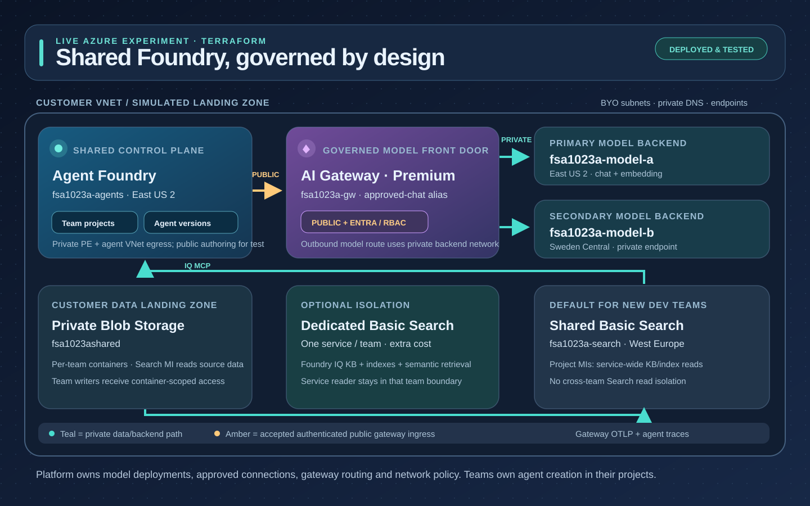
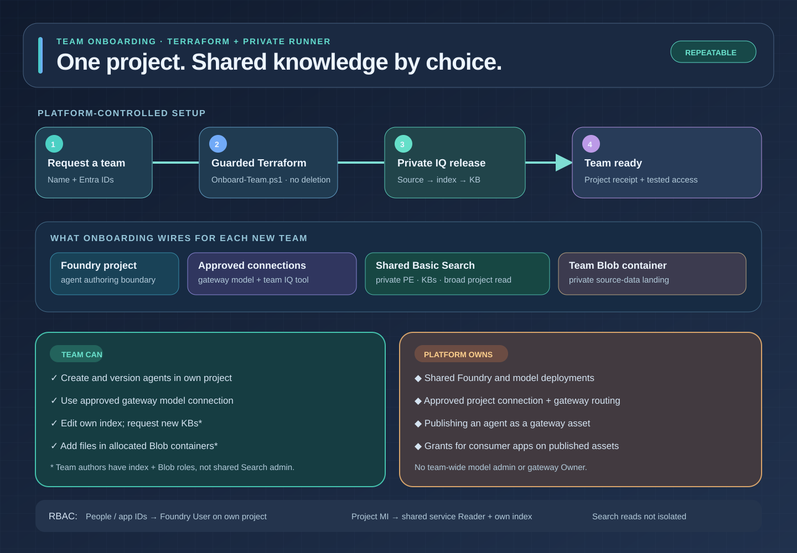
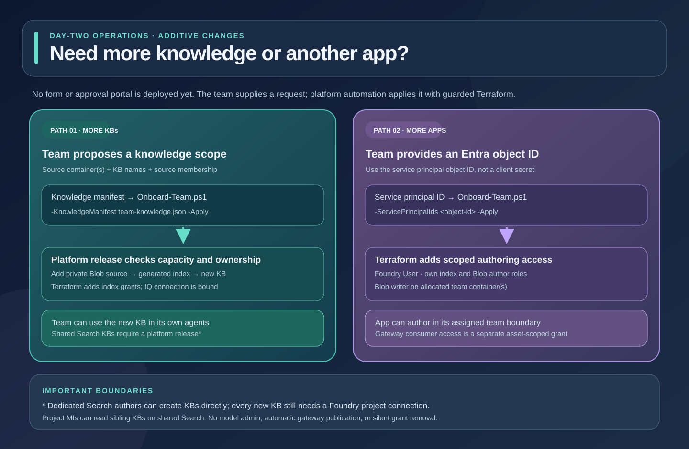

# Shared Foundry Accelerator

Terraform and scripts for one shared Microsoft Foundry platform and repeatable
team onboarding. The separate accelerator has been exercised against Azure;
the original identity lab is unchanged.

## What it deploys

- A shared **agent Foundry** with a separate project per team.
- Private **model backends** behind a shared **AI Gateway**.
- Private **Search and Blob knowledge** for Foundry IQ, with shared or
  dedicated Search per team.
- Entra/RBAC access, monitoring and token-usage showback.
- Agent templates, gateway publication and a sample client.

```text
Shared agent Foundry
  projects / prompt agents / Toolbox
                |
      Admin-connected BYOM, project MI
                v
      Independent APIM AI Gateway
         approved-chat alias
            /          \
        MI + PE      MI + PE
           |            |
     Model Foundry A  Model Foundry B
       Region A        Region B
      ingress only    ingress only, optional

Entra consumer -> gateway MCP tool -> private agent / Toolbox
Native OTLP -> Azure Monitor workspace -> identity-based project showback
```

## Start here: from landing zone to a working team

Assume your landing zone already provides the VNets, subnets, private DNS,
routing and Storage account. The platform operator deploys shared
infrastructure **once**; onboarding is repeated for **each team**.

| Step | Who | What happens | Detailed guide |
| --- | --- | --- | --- |
| 1. Deploy the platform | Platform operator | Deploy a shared agent Foundry, private model backends, AI Gateway, Search, telemetry and a private validation runner; configure the gateway's approved model alias. | [Deploy the platform](docs/deploy-platform.md) |
| 2. Onboard a team | Platform operator | Create a project, grant named members, connect the approved model and Search, provision that team's Blob source and Foundry IQ KB. | [Onboard a team](docs/onboard-team.md) |
| 3. Build and use agents | Team; platform operator for publication | Teams create/version agents and attach their KB. The operator publishes an approved agent through the AI Gateway; apps get consumer-only access. | [Team guide](docs/team-guide.md) |

Run these commands in PowerShell from this directory after signing in and
selecting the intended subscription:

```powershell
az login
az account set --subscription "<subscription-id>"
python -m pip install -r .\requirements.txt

# The existing landing zone supplies .local\network.json (see step 1).
.\scripts\Deploy-Platform.ps1 -Prefix myfsa01
.\scripts\Deploy-Platform.ps1 -Prefix myfsa01 -Apply
python -m accelerator.gateway configure-models `
  --deployment .local\deployment.json --output .local\gateway.json

.\scripts\Onboard-Team.ps1 -ProjectName my-team `
  -UserPrincipalIds "<team-user-Entra-object-id>"
.\scripts\Onboard-Team.ps1 -ProjectName my-team `
  -UserPrincipalIds "<team-user-Entra-object-id>" -Apply
.\scripts\Accept-Team.ps1 -ProjectName my-team
```

Without `-Apply`, the deployment scripts **plan only**; review each plan
before applying. Acceptance uploads a test document, verifies private KB
retrieval, publishes a test agent and checks gateway token usage. It uses the
default `<team>-docs`/`<team>-kb` knowledge manifest; custom manifests need
tailored checks. New teams reuse the shared gateway and Search by default.
**Shared Search shows other teams' KBs in Foundry Knowledge and grants project
identities service-wide read access.** For a team-only Knowledge view and
Search boundary, add `-DedicatedSearch -SearchLocation <region>` to **both**
onboarding commands before the team is first created. That incurs a separate
Basic Search charge.

The operator's acceptance is not a substitute for a team member signing in to
their project and checking access. No user-facing onboarding form is deployed.
The current dev profile permits Entra-authenticated public gateway ingress;
its model backends remain private.

For an optional **test** landing zone, run
`.\scripts\Deploy-Simulated-LZ.ps1 -Prefix myfsa01 -Apply` first. Do not run
that script against a customer landing zone. See
[the platform guide](docs/deploy-platform.md) for the existing-network
contract and safe reruns.

## Visual guides

Click a diagram to open the full-size, standalone SVG:

[](docs/diagrams/platform-architecture.svg)

[](docs/diagrams/team-onboarding.svg)

[](docs/diagrams/change-requests.svg)

The change-request diagram describes the existing script-based process; a
self-service form has **not** been deployed.

## More detail

- [Platform deployment and network inputs](docs/deploy-platform.md)
- [Team onboarding, KBs, RBAC and acceptance](docs/onboard-team.md)
- [What teams can do, agent publication and app access](docs/team-guide.md)
- [GitHub/GitLab CI/CD setup and approval gates](docs/ci-cd.md)
- [Architecture and ownership](docs/architecture-plan.md)
- [Regional routing and networking](docs/regional-deployment.md)
- [Agent template and release contract](docs/agent-deployment.md)
- [Usage attribution and showback](docs/chargeback.md)

## Scope

This is an operational **dev** profile, not a production HA or billing
solution. State and generated receipts are local under `.local/`; protect
state and use a remote backend for production. Hosted agents and a self-service
onboarding form are not implemented. Deployed resources remain running and
can incur charges; nothing is automatically destroyed. See the
[architecture](docs/architecture-plan.md) and [regional guide](docs/regional-deployment.md)
for implementation details and limitations.
