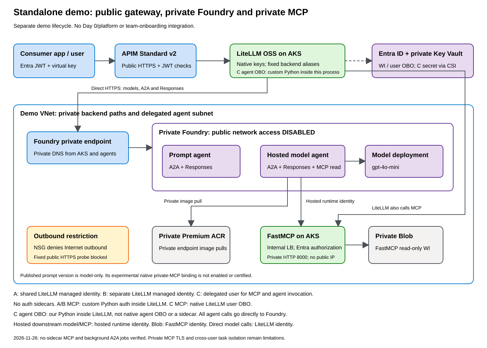

# Standalone demo: APIM + LiteLLM + private Foundry

**Start here for the demo. This is not the accelerator's Day 0 deployment or
Day 1/team onboarding.** It has its own infrastructure, identities, consumer
keys, deployment scripts, tests and lifecycle.

The demo demonstrates:

```text
Consumer -> APIM Standard v2 -> LiteLLM on AKS
                                 |-> private model endpoint
                                 |-> private FastMCP on AKS -> private Blob
                                 `-> private Foundry prompt / hosted agent
                                      A2A 1.0 and Responses
```

**Current implementation:** no authentication sidecars. Native LiteLLM
authentication is used where validated; the remaining token/protocol gaps
are custom Python inside the LiteLLM process. "Standalone" describes the
deployment boundary, not a claim that every feature is native LiteLLM.

## Read in this order

| Goal | Guide |
|---|---|
| Understand identities, native versus custom auth, and find the exact code/config | [Lab TL;DR and nine-path source map](docs/lab-guide.md#code-map-models-mcp-and-agents-in-a-b-and-c) |
| Call an existing deployment manually, one scenario at a time | [Tutorial A](docs/lab-guide.md#tutorial-a-shared-litellm-identity), [B](docs/lab-guide.md#tutorial-b-dedicated-litellm-identity), [C](docs/lab-guide.md#tutorial-c-signed-in-user-through-obo) |
| Submit an agent job and poll for its result | [Background A2A demo](docs/lab-guide.md#background-a2a-jobs-submit-and-poll) |
| Understand architecture, registrations, consent and boundaries | [Design and authentication flows](docs/design.md) |
| Deploy the private version yourself | [Private deployment sequence](docs/design.md#private-profile-upgrade-of-the-standalone-gateway) and [private Foundry prerequisites](infra/demo-private-foundry/README.md) |
| Revisit the original public test deployment | [Historical deployment reference](docs/deployment-reference.md) |

New deployments need Azure permissions, model quota, the appropriate hosted
agent preview access and network configuration. This is **not** an
empty-subscription one-line bootstrap.

## One folder, explicit responsibilities

```text
demos/apim_litellm/
  README.md                 This entry point
  docs/
    lab-guide.md            A/B/C manual tutorials and verification
    design.md               Architecture, identity flows and deployment
    deployment-reference.md Historical public-mode reference
    diagrams/               SVG + editable Excalidraw sources
  gateway/                  LiteLLM config, Dockerfiles, custom auth, FastMCP
  samples/
    consume_gateway.py      Consumer calls, including background jobs
    hosted-dual-agent/      Current model-backed A2A + Responses container
    hosted-a2a-echo/         Legacy deterministic transport sample
  operator/                 Demo deployment, identity, keys and verification CLIs
  scripts/                  Demo PowerShell entry points
  infra/                    Independent Terraform roots
  tests/                    Operator/consumer/wrapper tests
  gateway/tests/            Gateway runtime/auth tests
  requirements.txt          Demo operator/test dependencies
```

### Are these samples used by the accelerator?

| Code | Used by this demo? | Part of accelerator Day 0/Day 1? |
|---|---|---|
| [Gateway consumer](samples/consume_gateway.py) | Yes | **No** |
| [Dual-protocol hosted agent](samples/hosted-dual-agent/README.md) | Yes | **No** |
| [Legacy hosted Echo](samples/hosted-a2a-echo/README.md) | Optional historical sample | **No** |
| [Root accelerator agent consumer](../../samples/consume_agent.py) | No | **Yes:** native accelerator gateway/team workflow |

The old root `scenarios/apim-litellm`, demo `samples`, demo scripts and demo
guides have moved here. Use the commands below, not old chat snippets.
The accelerator's platform/team scripts and agent templates remain separate.

### What is still shared with the repository?

The demo currently imports only the reusable
[`accelerator.control`](../../accelerator/control.py) and
[`accelerator.mcp`](../../accelerator/mcp.py) utility modules from the
accelerator package. Private Terraform also reuses the
[Foundry](../../infra/modules/foundry) and
[project](../../infra/modules/project) resource modules.
[Demo requirements](requirements.txt) include the root dependency manifest.
These are code dependencies, **not calls to platform/team deployment**.

**Do not copy this folder alone into a new repository yet.** Extraction would
also need these shared utilities/modules and dependencies. No separate
repository has been created as part of this cleanup.

## Identity TL;DR: who calls the backend?

| Profile | Model call | MCP call | Prompt/hosted agent invocation |
|---|---|---|---|
| A: shared service | A's LiteLLM managed identity | Same identity; custom in-process workload auth | Same identity; native A2A federation / custom Responses auth |
| B: dedicated app boundary | B's LiteLLM managed identity | Same B identity; custom in-process workload auth | Same B identity; **not the consumer app's identity** |
| C: signed-in user | C's LiteLLM managed identity | User OBO, native LiteLLM exchange | User OBO, custom in-process agent integration |

The hosted agent uses its **own runtime identity** for downstream model/MCP
calls. FastMCP uses its own identity for Blob. Incoming user OBO does not
automatically propagate through those hops.

Code/config: [base LiteLLM YAML](gateway/config.yaml),
[profile renderer and pod identity binding](gateway/render.py),
[workload MCP auth](gateway/mcp_workload.py),
[agent A2A compatibility/OBO](gateway/foundry_a2a.py),
[agent Responses auth](gateway/agent_responses.py),
[OBO exchange](gateway/obo.py).

## Run a job against the existing demo

**All commands run from the repository root**, not this folder. Local state,
receipts, operator kubeconfig and encrypted user cache use root `.local/`
locations. The gateway's former implicit local state is preserved at
`.local/apim-litellm/terraform.tfstate`, with an explicit local backend in the
relocated stack. Private Foundry/model state keeps its existing `.local/`
location. No Azure resource deployment or recreation is part of this cleanup.

```powershell
# First-time demo dependency setup, in your chosen virtual environment:
python -m pip install -r .\demos\apim_litellm\requirements.txt

# Existing prepared lab environment:
$py = ".\.local\scenario-venv\Scripts\python.exe"
.\demos\apim_litellm\scripts\Import-GatewayConsumerEnv.ps1 -Scenario shared-service -UseAzd

& $py -m demos.apim_litellm.samples.consume_gateway --endpoint $env:GATEWAY_ENDPOINT --kind hosted-agent --agent-name hosted --background --poll-timeout 180 --prompt "Calculate 17 multiplied by 23. Return only the integer, no explanation."
```

Expected: an actual Task ID/state, separate `GetTask` calls, then a completed
artifact containing **391**. The sample never invents agent references or
treats echoed input as the answer. Select B/C using their credential loader
profile; see the lab for consent/login prerequisites.

For offline demo validation:

```powershell
& $py -m pytest demos\apim_litellm\tests demos\apim_litellm\gateway\tests -q
```

For the complete operator workflow, including Terraform and optional live
checks, use [Test-GatewayScenarios.ps1](scripts/Test-GatewayScenarios.ps1).
Live tests require real credentials and incur Azure usage.

## Diagrams

[](docs/diagrams/apim-litellm-private-demo.svg)

- [Identity and component placement](docs/diagrams/gateway-identity-scenarios.svg)
- [App registrations and consent](docs/diagrams/apim-litellm-demo-consent.svg)
- [Editable diagram sources](docs/diagrams)

## Known boundaries

Hosted agents use preview capabilities validated on the lab subscription.
Private MCP currently uses HTTP inside the VNet, not end-to-end TLS. The
published prompt agent is model-only; its experimental native private-MCP
binding is not enabled. Custom integrations are pinned to LiteLLM `1.110.2`
and need regression testing on upgrades. Cross-user Task isolation, crash
durability and production HA are not certified.
