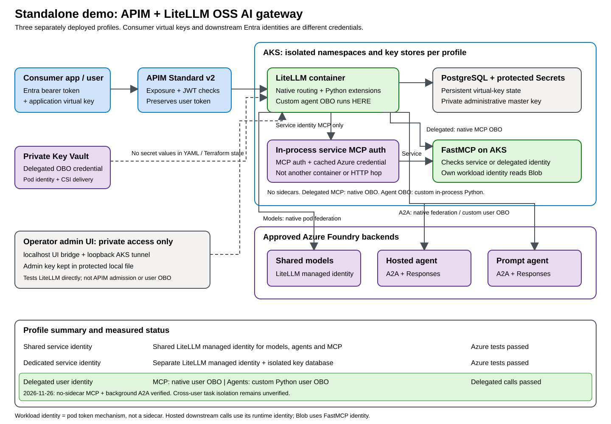

# Design: identities, native features and custom Python

[Overview](../README.md) | [Run tests](lab-guide.md) | [Deploy](deployment.md)

## Components are not identities

```text
Consumer -> APIM -> LiteLLM container -> approved backend
                    |                  model / FastMCP / Foundry agent
                    `-> Entra token acquisition/exchange
```

- **APIM:** API exposure and caller JWT validation. It does not replace the
  caller with its own managed identity to invoke these backends.
- **LiteLLM:** virtual-key permissions, routing and upstream authentication.
- **Workload identity:** the mechanism by which an AKS ServiceAccount obtains
  tokens as an assigned Azure managed identity. It is not a sidecar.
- **User OBO:** exchange a validated user assertion for a new target-scoped
  delegated token. It is not forwarding a gateway-audience token unchanged.
- **Custom Python:** code loaded inside the LiteLLM Python process. No custom
  authentication HTTP sidecar is deployed.

## Identity and implementation table

| Call | Shared service identity | Dedicated service identity | Delegated user identity |
|---|---|---|---|
| Direct model | Shared pod managed identity; native provider | Dedicated pod managed identity; native provider | User admitted at gateway, but model sees pod identity |
| Direct MCP | Shared pod identity; custom in-process token auth | Dedicated pod identity; same custom code | Actual user; native LiteLLM Entra OBO |
| Agent A2A | Shared pod identity; native OIDC federation | Dedicated pod identity; native OIDC federation | Actual user; custom in-process OBO |
| Agent Responses | Shared pod identity; custom auth callback | Dedicated pod identity; custom auth callback | Actual user; custom auth callback + OBO |
| Hosted agent -> model/MCP | Hosted runtime identity | Hosted runtime identity | Hosted runtime identity, not automatic user OBO |
| FastMCP -> Blob | FastMCP managed identity | FastMCP managed identity | FastMCP managed identity, not user Blob ACLs |

The dedicated scenario means a **separate LiteLLM deployment/service identity**,
not the consuming application's actual identity and not an identity bound to
one agent. Consumer-app passthrough is not implemented.

## Code and configuration map

| Concern | Source/config | Read this for |
|---|---|---|
| Registered models and agents | [config.yaml](../gateway/config.yaml) | Native provider aliases and A2A OIDC configuration |
| Profile-specific YAML and pod binding | [render.py](../gateway/render.py) | ServiceAccounts, fixed targets, native MCP OBO config, single-container gateway |
| Workload token acquisition | [identity.py](../gateway/identity.py) | Azure credential factory and token validators |
| Service-identity MCP gap | [mcp_workload.py](../gateway/mcp_workload.py) | Scoped native MCP-client wrapper attaching expiry-aware Azure SDK HTTP auth |
| Native inference pre-call callback | [request_policy.py](../gateway/request_policy.py) | Registered-target restrictions and original caller-token capture |
| Agent Responses token/URL handling | [agent_responses.py](../gateway/agent_responses.py) | Service token or user OBO for fixed agent endpoints; preview URL compatibility |
| Agent A2A compatibility/user OBO | [foundry_a2a.py](../gateway/foundry_a2a.py) | GetTask version/method correction and explicit delegated auth |
| User assertion validation/exchange | [obo.py](../gateway/obo.py) | Entra OBO, per-assertion/scope cache, explicit failure without workload fallback |
| FastMCP authorization/tools | [fastmcp_server.py](../gateway/fastmcp_server.py) | Verified whoami and read-only Blob tool |
| Named live HTTP assertions | [scenario_checks.py](../litellm_demo/scenario_checks.py) | Exact model/assistant/artifact and backend identity checks |
| Shared-service scenario | [Python example](../samples/test_shared_service_identity.py) | Explicit credential selection and six checks |
| Dedicated-service scenario | [Python example](../samples/test_dedicated_service_identity.py) | Separate deployed identity, not consumer passthrough |
| Delegated-user scenario | [Python example](../samples/test_delegated_user_identity.py) | Actual encrypted user cache, no operator fallback |

The base YAML is a template. The renderer adds deployment-owned targets and
identity-specific settings. The generated `workloads.json` under `.local/`
is not committed source and must not be shared as if it were generic config.

## How Python integrates with LiteLLM

The [official pre-call hook mechanism](https://docs.litellm.ai/docs/proxy/call_hooks#quick-start)
loads a `CustomLogger` instance referenced by YAML:

```yaml
litellm_settings:
  callbacks: [request_policy.policy]
```

For agent Responses, LiteLLM invokes the pre-call callback. Our code recognizes
the registered alias, obtains the correct token, sets the fixed backend URL
and credential, then lets LiteLLM send the HTTP request.

Other integrations are version-pinned startup wrappers, **not claims of
native features**:

| Integration | Why custom code is still needed in LiteLLM 1.110.2 |
|---|---|
| Workload MCP | The inspected native MCP resolver treats `oidc/azure/...` as static text; our code supplies real renewable workload tokens |
| Agent user OBO | The native A2A service-identity integration is not native agent user OBO |
| GetTask | Correct legacy `tasks/get` forwarding to native `GetTask` and preserve v1.0 |
| Dedicated agent Responses URL | Preserve the preview API version and acquire a bearer token for the exact published endpoint |
| MCP secret fields | Resolve the CSI-mounted OBO app credential for the pinned native MCP configuration |

Native [MCP Entra OBO](https://docs.litellm.ai/docs/mcp_obo_auth#microsoft-entra-id-azure-ad)
is retained. Native [Foundry A2A workload federation](https://docs.litellm.ai/docs/providers/azure_ai_agents#foundry-agents-over-a2a)
is retained. The generic hook extension point is native; the authentication
logic written in our modules is not.

## Secrets versus federation

For native service A2A federation:

```yaml
litellm_params:
  tenant_id: os.environ/AZURE_TENANT_ID
  client_id: os.environ/AZURE_CLIENT_ID
  azure_ad_token: oidc/azure/api://AzureADTokenExchange
  azure_scope: https://ai.azure.com/.default
```

The client ID identifies the managed identity; it is not a secret. Terraform
federates that identity with the exact AKS namespace/ServiceAccount, and the
AKS webhook projects a short-lived assertion into the pod.

**Delegated OBO currently needs a separate confidential app secret.** It is
stored in private Key Vault and delivered through workload identity + CSI.
Workload identity used to retrieve the secret does not make the OBO exchange
secretless. Virtual keys, database passwords and TLS keys also remain secrets.

## Network and hosting boundaries

Foundry/model endpoints, hosted-image registry, Blob and FastMCP are private
in the tested profile. APIM/LiteLLM public test surfaces are allowed.
The hosted agent's private MCP hop is HTTP inside the VNet, not end-to-end TLS;
production hardening is still required.

The hosted [dual-protocol implementation](../samples/hosted-dual-agent/README.md)
implements both A2A and Responses. The publisher separately declares container
protocols and enables published endpoints. LiteLLM does not turn a non-A2A
container into an A2A agent. The prompt agent is currently model-only; its
experimental native private-MCP binding is not enabled.

## Diagrams

[](diagrams/gateway-identity-scenarios.svg)

- [Private topology](diagrams/apim-litellm-private-demo.svg)
- [App registrations and consent](diagrams/apim-litellm-demo-consent.svg)
- [SVG and editable Excalidraw sources](diagrams)
