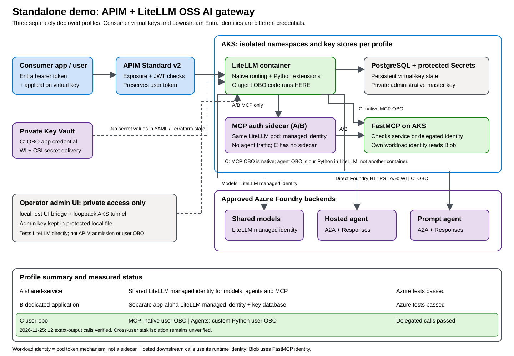

# Standalone demo: APIM + LiteLLM OSS identity scenarios

Start with the [demo README and per-scenario auth diagrams](../scenarios/apim-litellm/README.md).
This runbook deploys a standalone demo; it is **not integrated into Day 0
platform setup or Day 1/team onboarding**. Existing Foundry/model resources
are explicit inputs, not automatically onboarded team projects.

## TL;DR

**Every path is Consumer -> APIM -> LiteLLM OSS -> backend.** APIM exposes APIs
and validates the caller token. LiteLLM is the AI gateway: native virtual keys,
model routing and model/MCP/agent permissions. APIM does not invoke models or
agents directly and does not replace the consumer token with its own identity.

| | A: `shared-service` | B: `dedicated-application` | C: `user-obo` |
| --- | --- | --- | --- |
| Public APIM base path | `/ai` | `/ai-dedicated-application` | `/ai-user-obo` |
| Gateway admission | Application virtual key plus APIM caller token | Application virtual key plus APIM caller token | Application virtual key plus delegated user token for gateway app |
| Foundry **models** | Shared LiteLLM workload identity | Dedicated application's LiteLLM workload identity | LiteLLM workload identity, **not user OBO** |
| Hosted A2A **agent** | Native federated workload identity; direct Foundry URL | Dedicated workload identity; direct Foundry URL | Direct Foundry URL; custom in-process user OBO |
| Declarative A2A **agent** | Native federated workload identity; direct Foundry URL | Dedicated workload identity; direct Foundry URL | Direct Foundry URL; custom in-process user OBO |
| Custom **MCP** | LiteLLM workload identity | Dedicated application's workload identity | Native LiteLLM MCP Entra OBO |
| Backend sees | Gateway service principal | Explicit application-bound gateway principal | Delegated user and middle-tier application |
| Isolation mechanism | Native virtual-key model/object permissions and shared Azure RBAC | Separate namespace, PostgreSQL/key store, gateway workload identity and configurable Azure scopes | Native key permissions plus verified delegated audience/scopes/client/user allowlists and backend RBAC |
| Namespace | `gateway` | `gateway-app-alpha` | `gateway-user-obo` |
| OBO credential | Not required | Not required | App-registration secret in private Key Vault, mounted using workload identity |
| Failure behavior | Explicit denial | Explicit denial | Explicit denial; **never falls back to service identity** |
| Live Azure status, 2026-11-24 | Models, MCP, hosted/declarative A2A and key denials passed | Same checks passed with a different verified backend identity; foreign keys rejected | Passed with a real consented user: models, delegated MCP/identity, model-plus-MCP, hosted/declarative A2A, saved tasks and key denials |

[](diagrams/gateway-identity-scenarios.svg)

[Editable Excalidraw source](diagrams/gateway-identity-scenarios.excalidraw)
(open with the approved [Microsoft Excalidraw instance](https://aka.ms/excalidraw)).

B is an executable **app-alpha example**, not arbitrary automatic caller
impersonation. Its identity belongs to that gateway deployment; it is not derived
from a virtual key or caller-provided identity header. Its model/project scopes
default to the shared test resources. Set the dedicated scope Terraform inputs
to obtain narrower Azure resource isolation; a different principal alone does
not create a different data boundary.
When B uses a different model account or agent project, deploy that profile
individually with its matching `-ModelEndpoint` and agent endpoints; the combined
demo wrapper intentionally uses the same approved sample backends.

The original native `Microsoft.ApiManagement/aigateways` scenario remains
separate. These profiles use conventional **APIM Standard v2** and AKS.

### Current deployment and consent options

The three profiles are deployed in East US 2 using gateway release `20261124h`:

* `https://fsa-lit1120-apim.azure-api.net/ai`
* `https://fsa-lit1120-apim.azure-api.net/ai-dedicated-application`
* `https://fsa-lit1120-apim.azure-api.net/ai-user-obo`

Non-secret A/B/C success receipts are under
`.local\apim-litellm\<scenario>\acceptance.json`. On 2026-11-24, C passed live
acceptance through APIM after the allowlisted user completed interactive
consent and login. The test read that user's OS-encrypted MSAL cache; it did
not substitute an operator token or workload identity for delegated calls.

The opt-in registration receipt is
`.local\apim-litellm\entra-identity-user-consent.json`. That file confirms
configuration only; C's separate acceptance receipt proves the completed
runtime checks. Model inference also passed through C's user-admitted APIM
route, while the outbound model call continues to use the gateway workload
identity. Wrong-audience tokens remain rejected at APIM.

During the original admin-consent setup, the available lab identity could create the applications and securely store
their credential, but Microsoft Graph rejected
`POST /oauth2PermissionGrants` with **403 Authorization_RequestDenied**. It has
Global Reader, not the tenant-admin authority needed to consent. No user
assertion was fabricated and no service-identity fallback was enabled.

The lab resolved the blocker by allowing user consent on its two app-owned
scopes and configuring combined OBO consent for the test client. The user then
completed the real interactive flow. For a fresh deployment, follow the
[per-user consent instructions](#optional-per-user-consent-for-the-development-scenario).
Other tenants can still require administrator approval; no tenant policy or
resource RBAC was relaxed.

Alternatively, an authorized tenant administrator can complete **only consent**, without
Key Vault or Kubernetes access:

```powershell
# Sign into the intended tenant using an authorized admin account first.
# Without -Apply this is an offline plan.
.\scripts\Grant-GatewayConsent.ps1 `
  -IdentityFile .local\apim-litellm\entra-identity.json `
  -IncludeAzureCli -UseAzd -Apply
```

Use `-UseAzd` only for an administrator signed into Azure Developer CLI;
otherwise use the intended Azure CLI tenant login. `-IncludeAzureCli` is needed
only for the optional CLI development caller. The script updates the non-secret
receipt only after every requested grant succeeds. A denied attempt was tested
live and preserved the original non-consented receipt.

After allowed user consent or administrator consent, authenticate the actual
user and rerun C's live tests. Positive single-user OBO is now verified in this
lab. **Cross-user Foundry Task isolation remains unverified**: it requires
another independently authenticated user and explicit cross-user attempts.

Consented C validation on 2026-11-24:

* Model inference returned its exact marker through C's user-admitted APIM API;
  outbound model authentication remains workload identity.
* Native MCP OBO returned `authentication_mode: user-obo`, delegated scope
  `tools.read`, the gateway's client application and the expected allowlisted
  user identity. Personal user identifiers are not published in this guide.
* MCP read the actual Blob marker, both directly and through a model-plus-MCP
  Playground-style request. The expected contents were not supplied in that
  model request's prompt.
* Hosted Echo completed native A2A `SendMessage` and `GetTask` retrieved the
  same task/artifacts. The declarative agent returned `DECLARATIVE_OK`.
* Anonymous requests, missing/invalid virtual keys, unapproved models, and
  models-only keys attempting MCP/agent access were denied.
* C also rejected a shared-service virtual key with a valid user token, a
  missing user assertion, and a wrong-audience token with HTTP 401.
* The shipped combined A/B/C live-test script completed successfully:
  **173 selected Python tests and 10 subtests passed**, two local native-schema
  checks skipped, **6 Terraform tests passed**, and all three live profiles passed.
* This proves the configured single-user invocation path, not per-user Blob
  ACL propagation, cross-user task isolation, or token-expiry endurance.

Direct-routing release `20261124h` validation on 2026-11-24:

* **166 gateway regression tests and 10 subtests passed**, with two native-schema
  checks skipped locally on the unmatched LiteLLM version.
* A/B live acceptance passed with direct Foundry Echo and declarative-agent
  calls, saved-task retrieval, model-plus-MCP Blob reading and key denials.
* The exact admin Playground requests returned renderable agent output, and
  both registry entries expose the actual Foundry HTTPS URL.
* C's direct route rejected a missing delegated assertion with HTTP 401; its
  pod has no adapter container. Its later consented-user checks are recorded
  above; the earlier missing-consent result is no longer the current status.

Earlier complete baseline validation on 2026-11-24:

* **176 Python tests and 12 subtests passed**, preserving the original native
  gateway tests as well as the new identity scenarios.
* **6 Terraform tests passed**, including mandatory C audience configuration
  and independent per-profile trusted-TLS migration.
* The two native-schema tests skip on an unmatched local LiteLLM version; both
  were additionally executed successfully inside the deployed v1.110.2 image.
* The shipped `Test-GatewayScenarios.ps1 -Scenarios
  shared-service,dedicated-application -Live -UseAzd` completed successfully
  after final manifest convergence and pod restarts.
* A/B verified model inference, actual distinct MCP backend identities, Blob
  retrieval, hosted SendMessage/GetTask, declarative A2A output, models-only
  key denials, invalid/missing keys and rejection of the other profile's key.
* C verified private Vault credential delivery, workload-identity model
  inference at the private operator boundary, and 401 rejection of wrong-audience
  tokens on every APIM surface. These are not positive user-delegation tests.

## Authentication boundaries

```text
Caller: Authorization: Bearer <Entra token>
        x-litellm-api-key: Bearer <application virtual key>
                         |
                    APIM Standard v2
               validates caller JWT; blocks admin routes
                         |
                    LiteLLM OSS
              validates native PostgreSQL-backed key
                  /           |              \
             models           MCP          A2A agents
             pod WI        A/B: pod WI     A/B: pod WI
                          C: native OBO    C: in-process custom OBO
                                               |
                                       Direct Foundry HTTPS
```

In A/B, APIM's caller token can be the explicit Azure management-audience
development credential. Production should use a dedicated API audience and
authorized calling applications. In C, the incoming token must target the
gateway OBO app registration and contain `access_as_user`. An app-only token
cannot substitute for a user assertion.

APIM preserves `Authorization`; LiteLLM's custom key-header setting makes
`x-litellm-api-key` the admission credential. For A2A in C, APIM overwrites
per-agent forwarding headers from the validated Authorization header. Clients
cannot select a different backend identity by inventing those headers.
The C API additionally validates its dedicated gateway audience and the
delegated `access_as_user` scope before forwarding any request.

Public LiteLLM test listeners are diagnostic-only: restrict them to approved
operator/APIM sources and disable them for production. Otherwise a direct
connection could bypass APIM's caller-JWT checks; a native OSS virtual key is
not a replacement for those checks. Consumers use only the APIM endpoints.

**These are native virtual keys, not a homemade authentication replacement.**
The master key is a durable private administrative credential, never a consumer
key. Private bootstrap calls mint an `application` key with explicit
model/MCP/agent permissions, and a `models-only` key without tool/agent grants.
Reruns reconcile existing keys instead of replacing credentials.

### Direct Foundry agent routing and custom integration

Models use LiteLLM's native Azure credential provider with AKS Workload Identity.
MCP C uses LiteLLM's native `oauth2_token_exchange` / `entra_obo` implementation.
Native MCP environment-secret resolution is installed through the pinned
release's worker startup hook because those flat OAuth fields need resolving.

**All agent requests go directly from LiteLLM to the Foundry HTTPS URL.**
The agent registry no longer points at `127.0.0.1:4001`. In A/B, native LiteLLM
exchanges the AKS projected service-account assertion for a renewable Foundry
access token. No SP secret, manually copied access token or middle HTTP service
is involved. The token file is injected by the AKS Workload Identity webhook.
The rendered Echo entry has this shape:

```yaml
agents:
  - agent_name: echo
    agent_card_params:
      name: Echo
      url: https://<account>.services.ai.azure.com/api/projects/<project>/agents/gateway-a2a-echo/endpoint/protocols/a2a
      protocolVersion: "1.0"
      capabilities:
        streaming: false
    static_headers:
      a2a-version: "1.0"
    litellm_params:
      agent_card_path: agentCard/v1.0
      tenant_id: os.environ/AZURE_TENANT_ID
      client_id: os.environ/AZURE_CLIENT_ID
      azure_ad_token: oidc/azure/api://AzureADTokenExchange
      azure_scope: https://ai.azure.com/.default
```

See [LiteLLM's Foundry A2A documentation](https://docs.litellm.ai/docs/providers/azure_ai_agents#foundry-agents-over-a2a).
The supported native OIDC exchange was verified in the deployed v1.110.2 image.
The current pinned release still normalizes incoming `GetTask` to legacy
`tasks/get`, which Foundry rejects with JSON-RPC `-32601`. The worker startup
hook in [foundry_a2a.py](../scenarios/apim-litellm/foundry_a2a.py) corrects that
method only for configured Foundry targets, immediately before LiteLLM sends
the request. This is a **custom in-process compatibility patch**, not an
upstream-native protocol fix or a separate HTTP proxy.

Hosted/declarative A2A OBO is **custom integration**, not a claim of native
Enterprise/OSS A2A OBO support. The same in-process integration verifies the user assertion, exchanges
it for the Foundry scope, caches separately per user assertion/scope, and uses
the delegated token for protected discovery and invocation. It does not modify
the registry with user credentials and never falls back to workload identity.
The lab's consented single-user C invocation passed for both agents and MCP.
Fresh users/deployments still need actual consent/login and may require
administrator approval under their tenant policy.

The loopback HTTP adapter is retained **only for A/B service-identity MCP**;
it has no configured Foundry targets. C uses native MCP OBO plus the in-process
agent integration, so its LiteLLM pod no longer contains an adapter container.

### MCP data access is explicit

`whoami` returns verified non-secret caller claims to demonstrate the identity
that reached FastMCP. Blob tools still read an approved shared container using
**FastMCP's own read-only workload identity**. This demonstrates delegated tool
authorization, not per-user Blob ACL propagation. User-specific data requires
additional per-user authorization or another explicitly supported OBO hop.
Likewise, delegated agent invocation does not prove that every tool inside an
agent inherits the user's identity.

## Private LiteLLM admin UI

The UI is intentionally **not published through APIM**. Consumer traffic still
uses APIM; administration uses a separate operator-only local tunnel.

```powershell
# Install the optional scenario dependencies first, and ensure kubectl/kubelogin
# plus the intended Azure Developer CLI login are available.
.\scripts\Open-GatewayAdmin.ps1 -Scenario shared-service
```

Keep that command running. Open **http://localhost:4401/ui/login/**:

* Username: **admin**
* Password/admin key: the contents of
  `.local\apim-litellm\admin\shared-service-admin.key`.
* The launcher retrieves the existing key from `litellm-auth`, never prints it,
  and restricts the local file to the current account. Local OS administrators
  retain their normal ability to override filesystem controls.
* To copy the password explicitly while the UI is already running:
  `.\scripts\Open-GatewayAdmin.ps1 -Scenario shared-service -CopyAdminKey -ExportKeyOnly`.

The launcher binds only `127.0.0.1`. Port 4400 is a verified-TLS AKS tunnel;
4401 is a loopback-only HTTP development UI bridge. The bridge adjusts UI
discovery and login redirects to localhost because the deployed
`PROXY_BASE_URL` correctly points to the consumer APIM URL. It does **not**
change the deployed gateway configuration, expose admin routes through APIM,
or create an unauthenticated remote admin endpoint. It rejects foreign browser
origins and non-loopback Host headers. Do not publish or remotely forward these
local ports. Ctrl+C closes a manually started launcher and its child tunnel.
Rerun the launcher if the selected gateway pod restarts.

Use `-Scenario dedicated-application -Port 4411 -TunnelPort 4410` for B; each
namespace has a different administrative key. Prefer one scenario at a time,
or separate browser profiles: localhost cookies are not isolated by port.

### Can the UI test the scenarios?

| UI action | Supported use |
| --- | --- |
| Model Playground | Choose the configured `enterprise-chat` alias; streaming is supported. |
| MCP / tools | Select `enterprise-chat` plus the registered `blob` MCP tools; ask it to read `gateway-check.txt`. |
| Agents / A2A Playground | Select `echo` or `declarative`; use non-streaming `message/send`. |
| Virtual-key management | Inspect/create/restrict keys in this namespace's persistent database. |
| APIM JWT admission and application-key isolation | Use `Test-GatewayScenarios.ps1`; direct admin UI calls do not test APIM. |
| User OBO | Verified through the scripted C consumer flow with a real delegated user token. Admin UI login alone is **not** a user assertion and does not reproduce that flow. |

Verified using the actual UI login/session and exact Playground HTTP requests:
model catalog, a streaming model response, model-plus-MCP Blob reading, hosted
Echo A2A and declarative-agent A2A all succeeded through the local bridge. The
model-plus-MCP test requires the actual Blob marker without including it in the
prompt; it also runs in scripted live acceptance through APIM.

The original `403 Backend overrides are not permitted` was an accelerator
policy bug: the guard also rejected LiteLLM's own registered MCP selector.
Release `20261124g` and later allow only registered selectors, not arbitrary MCP URLs,
provider overrides or caller-supplied backend credentials. In the Playground,
enable `blob-read_blob` and ask: **Use the blob MCP tool to read
gateway-check.txt and return its exact contents.** The expected document contains
`MCP_WORKLOAD_IDENTITY_OK`.

For agents, send **hello** to `echo` (expected **Echo: hello**) or ask
`declarative` to **Reply exactly DECLARATIVE_OK**. Foundry preview streaming is
not enabled. The pinned LiteLLM UI sends legacy `message/send` and expects
legacy-shaped results; the local admin bridge normalizes only that UI response
for display. The deployed gateway and APIM consumer endpoints retain native
A2A 1.0 `SendMessage`/`GetTask` envelopes. A UI **Needs Setup** badge on these
config-managed entries is not a backend health check.
Agent details now show the actual Foundry HTTPS URL rather than the old loopback
address. Keep `agent_card_path: agentCard/v1.0` and the Entra parameters together;
the standard well-known card path is not Foundry's protected-card endpoint.

The admin role bypasses normal consumer-key limits;
use consumer keys and the scripted negative tests to verify application
authorization. Model/MCP/agent definitions remain source/config-managed, so do
not assume dashboard edits replace the release workflow.

Never use the master key as an application virtual key, put it in YAML/Git, or
send it through the public APIM consumer API. For long-lived administration,
create personal admin accounts or configure the customer's supported SSO rather
than sharing the bootstrap password.

## Deployment sequence

For a greenfield laptop deployment with a **private** Vault, use this order:
infrastructure (1), publish agents (3), bootstrap A only, provision/consent
applications through A's connected pod (2), deploy all profiles (4), then test
(5). A has no dependency on the OBO app registration, so this is not circular.
An already connected release runner can perform step 2 directly.

### 1. Tools, subscription and initial infrastructure

Use the tools and landing-zone inputs from [the APIM/LiteLLM guide](apim-litellm.md).
Select the intended subscription explicitly; the Terraform provider also pins
the tenant. Do not rely on another terminal's active corporate/lab account.

```powershell
python -m pip install -r samples\apim-litellm-requirements.txt

# Copy the example and supply actual IDs, tenant, publisher and operator.
# Save JSON script inputs under the ignored .local directory.
.\scripts\Deploy-APIMLiteLLM.ps1 `
  -VariablesFile .local\apim-litellm.tfvars.json -Stage infrastructure
```

Enable the optional identity resources in an additional local JSON file:

```json
{
  "enable_identity_scenarios": true
}
```

```powershell
.\scripts\Deploy-APIMLiteLLM.ps1 `
  -VariablesFile .local\apim-litellm.tfvars.json `
  -ScenarioVariablesFile .local\apim-litellm\identity-scenarios.tfvars.json `
  -Stage infrastructure -Apply
```

This adds independent B/C user-assigned managed identities, exact namespace/SA
federation subjects, role assignments, the Key Vault CSI add-on, a private Key
Vault endpoint and private DNS. C's gateway identity receives model inference
and Vault read access, **not a fallback Foundry agent-consumer grant**.

The test deployment may keep a public LiteLLM test listener. APIM uses internal
TLS load balancers over its VNet integration; FastMCP and PostgreSQL are private.
The development self-signed backend TLS bypass is explicit and must not be used
with production trusted certificates.

### 2. Create and consent Entra applications

If no connected pod exists yet, publish the agents from step 3 and bootstrap A:

```powershell
.\scripts\Deploy-GatewayScenarios.ps1 `
  -VariablesFile .local\apim-litellm.tfvars.json -Scenarios shared-service `
  -FoundryA2AEndpoint "<hosted-A2A-base-URL>" `
  -DeclarativeA2AEndpoint "<declarative-A2A-base-URL>" `
  -ModelEndpoint "https://<account>.openai.azure.com/" -Apply
```

The identity setup script plans without authenticating or writing by default.
It creates/reconciles:

* `PREFIX-gateway`: confidential middle-tier API exposing `access_as_user`;
* `PREFIX-mcp`: resource API exposing delegated `tools.read`;
* `PREFIX-test-client`: public test client requesting the gateway's scope;
* service principals and downstream delegated permissions, discovering the real
  Azure AI permission IDs rather than hard-coding them;
* an OBO client secret stored **only in Key Vault**, plus non-secret receipts.

```powershell
.\scripts\Initialize-GatewayIdentity.ps1 `
  -TenantId "<tenant>" -SubscriptionId "<subscription>" `
  -ProjectId "<Foundry-project-ARM-ID>" -Prefix "<prefix>" `
  -KeyVaultUrl "https://<vault>.vault.azure.net" `
  -PermittedUserObjectId "<authorized-test-user-object-ID>" `
  -Output .local\apim-litellm\entra-identity.json

# Explicit tenant writes AND explicit tenant-wide admin consent:
.\scripts\Initialize-GatewayIdentity.ps1 `
  -TenantId "<tenant>" -SubscriptionId "<subscription>" `
  -ProjectId "<Foundry-project-ARM-ID>" -Prefix "<prefix>" `
  -KeyVaultUrl "https://<vault>.vault.azure.net" `
  -PermittedUserObjectId "<authorized-test-user-object-ID>" `
  -Output .local\apim-litellm\entra-identity.json `
  -Apply -GrantAdminConsent
```

Graph scopes do not replace directory authorization. Admin consent requires an
authorized tenant administrator; Azure subscription Owner is insufficient.
`-PreauthorizeAzureCli` additionally authorizes the known Azure CLI application
for development token acquisition. Do not enable it implicitly for production.
`-UseAzd` selects the separately signed-in Azure Developer CLI credential.

For private Vault access from a laptop, use VPN/private DNS, a connected release
runner, or `-KeyVaultProxyNamespace gateway`: the script performs Vault-only
requests through `kubectl exec` in the existing FastMCP pod. It retains the
operator's Vault token/RBAC, passes token/secret via stdin only, has no proxy
listener and does not weaken the Vault firewall. Deploy A first to provide that
connected pod. Graph calls remain direct.

Consent can be completed later by an administrator rerunning the same command.
An apply **without** `-GrantAdminConsent` records that consent was not performed;
it must not be presented as a completed OBO setup.
Alternatively use `Grant-GatewayConsent.ps1` for the separate Graph-only admin
phase; it does not read secrets or require access to the private Vault.

### 3. Publish hosted and declarative agents

Deploy [the hosted Echo sample](../samples/hosted-a2a-echo/azure.yaml) as described
in the existing guide. Then create/reconcile the declarative A2A sample:

```powershell
python -m accelerator.gateway_agents `
  --project-endpoint "https://<account>.services.ai.azure.com/api/projects/<project>" `
  --project-id "<project-ARM-ID>" --tenant-id "<tenant>" `
  --model gpt-4o-mini --output .local\apim-litellm\declarative-agent.json
```

Add `--use-azd` when appropriate. For delegated Foundry invocation, explicitly
grant the authorized user's runtime role with `--user-object-id "<user-OID>"`.
This is Azure RBAC, not Entra consent; both must be satisfied. Do not grant the
gateway MI broad Foundry access to make a failed delegated call succeed.

### 4. Deploy the named profiles

```powershell
# Plan infrastructure first; omit -Apply.
.\scripts\Deploy-GatewayScenarios.ps1 `
  -VariablesFile .local\apim-litellm.tfvars.json `
  -IdentityFile .local\apim-litellm\entra-identity.json `
  -FoundryA2AEndpoint "<hosted-A2A-base-URL>" `
  -DeclarativeA2AEndpoint "<declarative-A2A-base-URL>" `
  -ModelEndpoint "https://<account>.openai.azure.com/"

# Apply the reviewed plan, build images once, deploy all three namespaces.
.\scripts\Deploy-GatewayScenarios.ps1 `
  -VariablesFile .local\apim-litellm.tfvars.json `
  -IdentityFile .local\apim-litellm\entra-identity.json `
  -FoundryA2AEndpoint "<hosted-A2A-base-URL>" `
  -DeclarativeA2AEndpoint "<declarative-A2A-base-URL>" `
  -ModelEndpoint "https://<account>.openai.azure.com/" `
  -KubernetesLoginMethod azd -Apply
```

Use `-Scenarios shared-service,dedicated-application` to deploy A/B before the
tenant administrator completes C. Use `-SkipBuild` only for an already built
immutable image tag. Individual profiles can be managed with
`Deploy-APIMLiteLLM.ps1 -Scenario <name>` and the same scenario variables file.

The wrapper creates per-namespace durable master/database credentials,
PostgreSQL StatefulSet/PVC, runtime Deployments, Secret references, restricted
native client keys, and APIM routes. It never writes secrets to Terraform
variables/state or a ConfigMap. Native key management is reached through
private `kubectl exec`, not the consumer-facing APIM route.

PostgreSQL is a **single-node test database**, not a production HA database.
Its disk and Kubernetes Secret must be backed up together. The bootstrap refuses
to invent new credentials if a retained PVC exists without its original Secret.
Use approved PostgreSQL patch/digest, backups, TLS and managed database/secret
delivery for production. Do not delete the PVC to recover from an authentication
error. Native virtual-key hashes survive pod restarts; the administrator master
key must remain private and durable.

C mounts the OBO app secret from Vault using the C pod's workload identity.
No client secret is needed to read Vault. CSI can rotate the mounted file;
restart/reconcile LiteLLM after OBO secret rotation because the native MCP
configuration loads its environment value at startup. Use
`-RotateOboSecret` deliberately, not on every deployment.

### 5. Acquire a real user token and test

The setup script includes device-code login for the public test client:

```powershell
python -m accelerator.entra_setup login `
  --identity .local\apim-litellm\entra-identity-user-consent.json `
  --token-cache .local\apim-litellm\user-obo\user-token-cache.bin
```

This requires a real user to sign in; no synthetic user tokens or username/
password shortcuts are used. Optional persistent MSAL cache requires
`msal-extensions` and an available OS-encrypted persistence provider.
The lab uses the public test client's encrypted cache. The older optional
CLI-user path instead needs `-PreauthorizeAzureCli`, administrator consent and
a tenant-correct user login; it is not an implicit fallback for the selected cache.
The exact incoming `aud` for the v2 apps is the app GUID, while requested scopes
use `api://<app-id>/...`; the renderer configures them separately.

```powershell
.\scripts\Test-GatewayScenarios.ps1
# All three profiles; the encrypted user cache is used only for C.
.\scripts\Test-GatewayScenarios.ps1 -Live -UseAzd `
  -Scenarios shared-service,dedicated-application,user-obo `
  -IdentityFile .local\apim-litellm\entra-identity-user-consent.json `
  -UserTokenCache .local\apim-litellm\user-obo\user-token-cache.bin
```

Live tests require real credentials and fail on missing consent or missing keys.
They verify model inference, restricted-key denials, blocked management APIs,
MCP initialization/read, verified caller identity, hosted native A2A send/saved
Task retrieval and declarative-agent invocation. A JSON-RPC error inside HTTP
200 is not success. Tests do not silently skip an unavailable OBO path.

Retrieve a consumer key only through an explicit protected export:

```powershell
$env:KUBECONFIG = (Resolve-Path .local\apim-litellm\kubeconfig).Path
python -m accelerator.gateway_keys export-key --scenario shared-service `
  --alias application --output .local\shared-service-client.key
```

Protect the file's Windows ACL and never paste it into source, terminal logs,
chat or a ticket. In an application, send it in `x-litellm-api-key` and send the
appropriate Entra token separately in `Authorization`.

The consumer sample needs no AKS access and never uses an administrator key:

```powershell
$env:LITELLM_VIRTUAL_KEY = Get-Content .local\shared-service-client.key -Raw
# GATEWAY_ACCESS_TOKEN is acquired by your application's Entra login.
python -m samples.consume_gateway --endpoint "https://<apim>.azure-api.net/ai" --kind model
python -m samples.consume_gateway --endpoint "https://<apim>.azure-api.net/ai" --kind mcp
python -m samples.consume_gateway --endpoint "https://<apim>.azure-api.net/ai" --kind hosted-agent
python -m samples.consume_gateway --endpoint "https://<apim>.azure-api.net/ai" --kind declarative-agent
```

For C, use its endpoint and virtual key plus `--identity` and
`--user-token-cache` to select the explicitly encrypted user cache instead of
an environment bearer. A failed selected login never falls back to another user.

## Optional per-user consent for the development scenario

New API registrations still default to **admin-only** scopes. To opt existing
development registrations into user consent without changing tenant policy:

```powershell
# Plan only; no authentication or writes.
python -m accelerator.entra_setup user-consent `
  --identity .local\apim-litellm\entra-identity.json

# App-owner operation; no Vault/AKS access, secret rotation, or permission grants.
python -m accelerator.entra_setup user-consent `
  --identity .local\apim-litellm\entra-identity.json `
  --output .local\apim-litellm\entra-identity-user-consent.json `
  --use-azd --apply
```

The command preserves the existing app and scope IDs. It changes only the
gateway `access_as_user` and MCP `tools.read` scopes from `Admin` to `User`,
temporarily disabling each scope before changing its consent metadata as
required by Graph. A failed scope update attempts to restore its original
enabled configuration and reports failure explicitly. Other scopes, tenant
policy, API permission requirements, RBAC and existing grants are not changed.

The gateway API also records the existing public test-client app in
`knownClientApplications`. Login then requests the gateway's `/.default` scope,
so Entra can present the combined client -> gateway -> downstream consent.
The Azure AI delegated permission must itself be user-consent eligible; the
command checks it before changing either custom API.

**Configured does not mean consented.** The new receipt says
`consent_mode: user` and `user_consent_configured: true`; it does not mark
administrator consent as granted or manufacture a user token. Complete a real
interactive login with the intended allowlisted user:

```powershell
python -m accelerator.entra_setup login `
  --identity .local\apim-litellm\entra-identity-user-consent.json `
  --token-cache .local\apim-litellm\user-obo\user-token-cache.bin

.\scripts\Test-GatewayScenarios.ps1 -Scenarios user-obo -Live -UseAzd `
  -IdentityFile .local\apim-litellm\entra-identity-user-consent.json `
  -UserTokenCache .local\apim-litellm\user-obo\user-token-cache.bin
```

The cache uses OS encryption, never plaintext. A missing/invalid user cache
cannot fall back to the operator's login or the gateway workload identity.
Tenant policy may still require administrator approval for these applications;
this option does **not** disable that policy, claim publisher verification, or
grant the user any additional Foundry/Blob access. A/B service-identity scenarios
do not depend on these interactive grants and remain independently testable.

See [Microsoft's combined OBO consent guidance](https://learn.microsoft.com/en-us/entra/identity-platform/v2-oauth2-on-behalf-of-flow#default-and-combined-consent).

This sequence was completed successfully in the lab on 2026-11-24, including
positive MCP and hosted/declarative A2A OBO calls. An existing configuration
receipt alone is still not evidence that a different user or deployment has
completed consent; rerun the real login and acceptance steps.

## Explicit non-goals and remaining verification

* A virtual key is an application credential, not an Entra user identity.
* No automatic per-application Entra impersonation occurs in B.
* Agent OBO is custom code, live-tested here against the selected preview;
  customer deployments and upgrades require their own acceptance.
* User invocation of an agent is not automatic user propagation to its tools.
* Shared Blob tools are not per-user Blob ACL isolation.
* Streaming, multipart file processing, long token-expiry endurance and
  cross-user Foundry Task isolation require their own measured acceptance.
* A fully private customer deployment additionally needs trusted TLS,
  enterprise DNS/egress, private AKS/registry access and a connected release runner.
* AzureRM/APIM can normalize raw policy XML and show formatting-only policy
  updates on a rerun. Review the saved plan; do not hide policy changes with
  `ignore_changes`. Deletion/replacement plans remain blocked by the wrapper.

Resources remain billable. Nothing here automatically destroys shared Azure
accounts, app registrations, consent grants, Key Vault secrets or persistent
database volumes.
