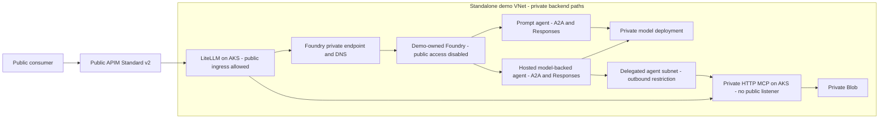
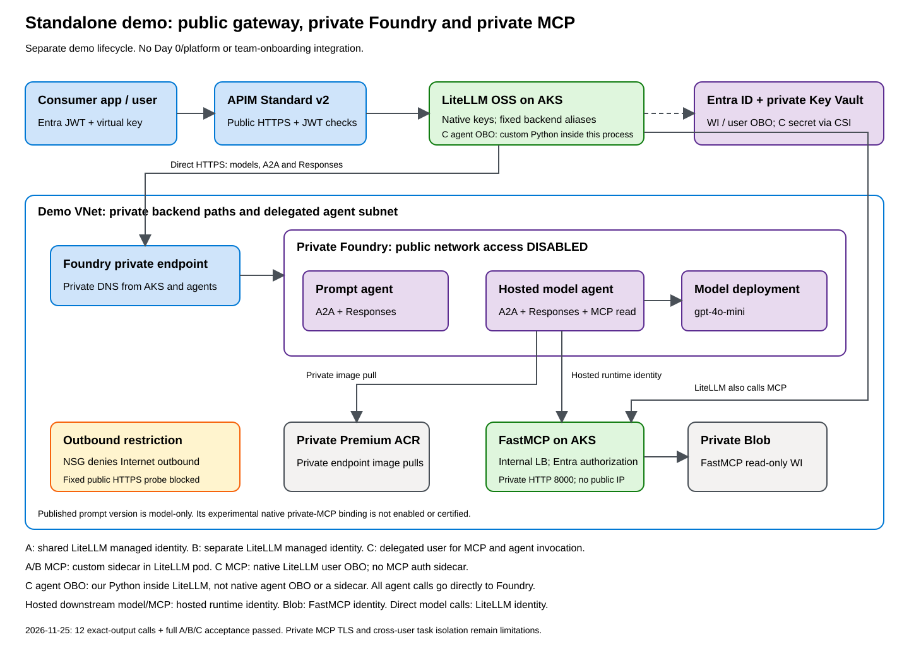
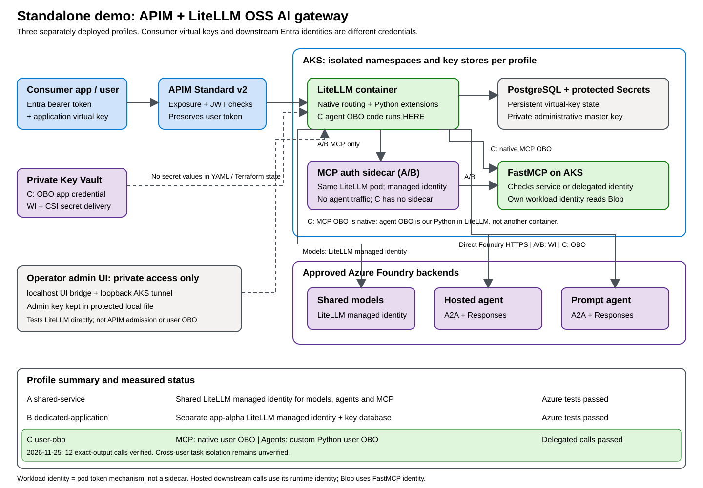
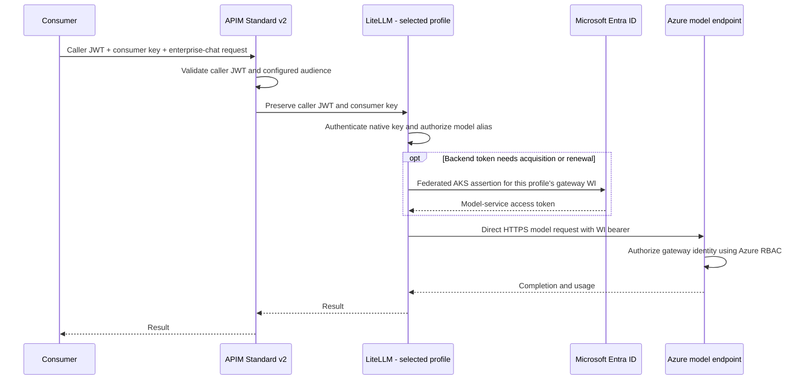
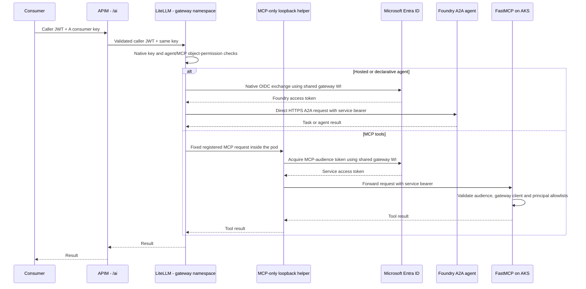
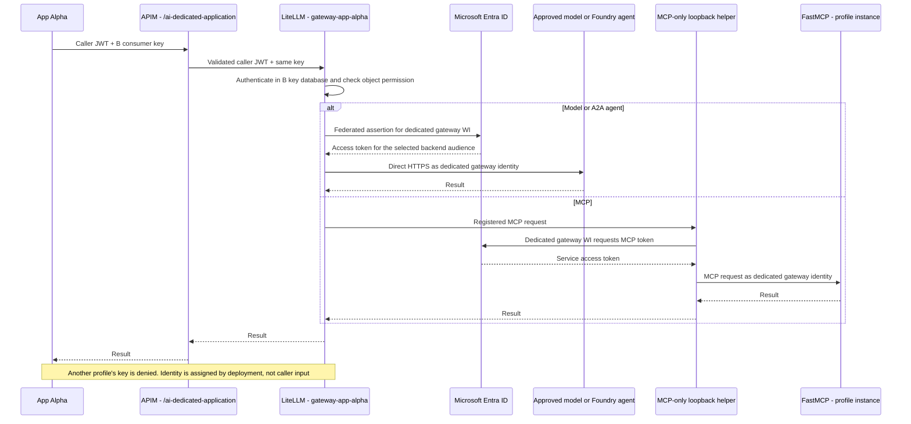
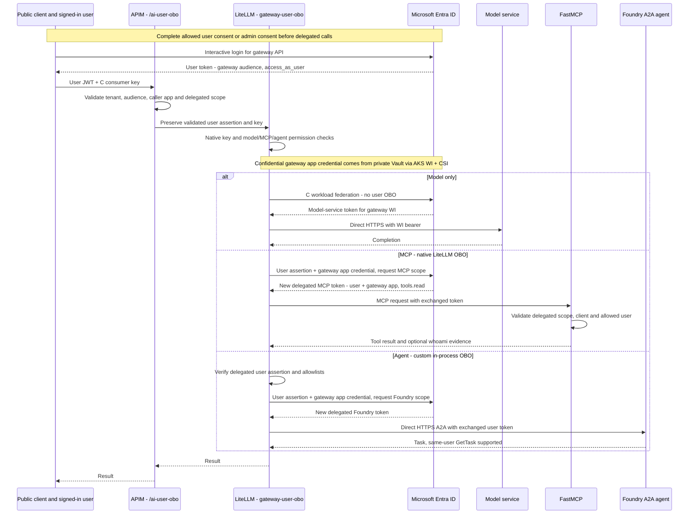
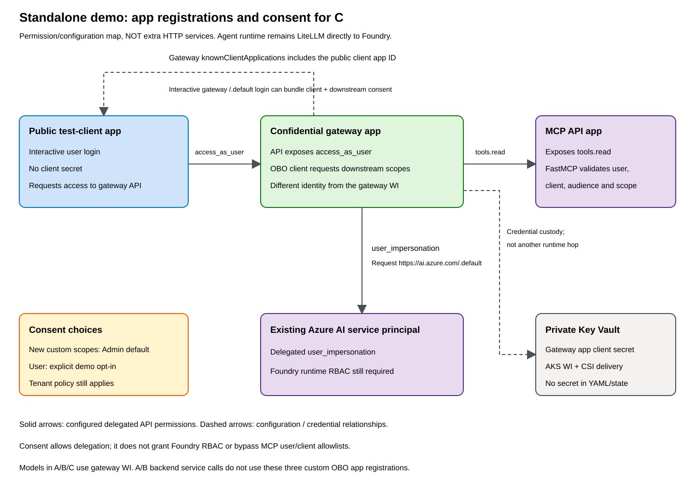

# Standalone demo: APIM + LiteLLM on AKS

**This is a demo, not an integration into the Shared Foundry Accelerator's
Day 0 infrastructure or Day 1/team-onboarding workflows.** It deploys real
Azure resources and has been live-tested, but has its own Terraform state,
configuration, identities, consumer keys and release scripts.

The demo can **reuse an explicitly supplied Foundry project/model account** or
provision a **demo-owned private Foundry account, project and model** alongside
the standalone gateway VNet. The private profile below is now deployed.
Existing-resource model and hosted-Echo helpers remain available; there is no
manual agent-code copying step.
It does not create projects for teams, onboard members, provision team knowledge,
or automatically publish each team's models/agents into LiteLLM. A/B/C below
are authentication examples, not automated team lifecycle stages.

Jump to: [Models](#model-calling-applies-to-a-b-and-c),
[A](#a-shared-gateway-service-identity),
[B](#b-dedicated-backend-identity-per-application-boundary),
[C](#c-actual-user-delegation-with-obo),
[registrations and consent](#app-registrations-permissions-and-consent),
or [deployment and tests](#deploy-and-test-this-standalone-demo).

For copy/paste commands, expected outputs and protocol evidence, use the
[hands-on lab: prompt/hosted agents over Responses and A2A](../../docs/gateway-identity-scenarios.md#hands-on-lab-test-prompt-and-hosted-agents-through-both-apis).

**New to the components?** Start with the
[nine-path TL;DR code/config map](../../docs/gateway-identity-scenarios.md#code-map-models-mcp-and-agents-in-a-b-and-c).
It links each A/B/C model, MCP and agent path to exact live-tested GitHub
source, then to a manual lesson:
[A: shared LiteLLM identity](../../docs/gateway-identity-scenarios.md#tutorial-a-shared-litellm-identity),
[B: dedicated LiteLLM identity](../../docs/gateway-identity-scenarios.md#tutorial-b-dedicated-litellm-identity),
[C: signed-in user OBO](../../docs/gateway-identity-scenarios.md#tutorial-c-signed-in-user-through-obo).
Each lesson has a small flow diagram, setup command, model/MCP calls, four
agent calls and a separate identity-verification step. Workload identity,
an MCP sidecar and custom Python inside LiteLLM are explicitly different.

## What this demo shows

### Current private profile: deployed and tested on 2026-11-25

The gateway release is `20261125g`. The private Foundry account is
`fsapriv1125`, project `private-gateway-demo`; its public network access is
**Disabled**. The private image registry is `fsapriv1125acr`.

| Consumer alias / route | Private backend | Authentication |
|---|---|---|
| `enterprise-chat` via `/v1/chat/completions` | Private model deployment | Selected gateway's AKS workload identity |
| `prompt-agent-responses` via `/v1/responses` | Prompt agent's dedicated Responses endpoint | Gateway WI in A/B; actual user OBO in C |
| `hosted-agent-responses` via `/v1/responses` | Model-backed hosted agent's dedicated Responses endpoint | Gateway WI in A/B; actual user OBO in C |
| `/a2a/declarative` | Same private prompt agent | Gateway WI in A/B; actual user OBO in C |
| `/a2a/hosted` | Same private hosted agent | Gateway WI in A/B; actual user OBO in C |
| `/blob/mcp` | Profile's private AKS MCP | Gateway WI in A/B; native MCP OBO in C |

The private profile removes the legacy `echo` registry entry; Echo's code
sample and earlier public-account deployment are preserved separately. The
new hosted agent performs actual model inference, not deterministic echoing.



The MCP link in the deployed demo is **private HTTP on port 8000, not TLS**;
use trusted HTTPS for production. The published prompt version is model-only.
Its experimental native private-MCP binding returned `tool_user_error` and is
not enabled; hosted-agent private MCP reads are verified.

[](../../docs/diagrams/apim-litellm-private-demo.svg)

[Editable private diagram](../../docs/diagrams/apim-litellm-private-demo.excalidraw),
[private infrastructure runbook](../../infra/stacks/demo-private-foundry/README.md),
and [model-backed dual-protocol hosted sample](../../samples/hosted-dual-agent/README.md).

**Measured, not inferred:** all A/B/C profiles passed model inference, both
agents over A2A, hosted saved-task retrieval, both agent Responses aliases,
hosted-to-private-MCP Blob reads, key/agent-override denials and a fixed public
HTTPS denial probe. C used the real encrypted user login. The outside-VNet
operator request to Foundry returns HTTP 403 while the private path succeeds.
This is not certification of every possible egress path or cross-user isolation.
Final validation passed 230 Python tests and 17 subtests (two local native-schema
checks skipped), six gateway Terraform tests, a zero-change private Foundry plan,
and live acceptance for all three profiles.

The original `aif-agentgw-xlen9` account is not part of this private profile.
It remains public-enabled with a private endpoint; do not confuse it with the
new private-only account.

```text
Consumer -> APIM Standard v2 -> LiteLLM OSS on AKS -> approved backend
                                                   |- Foundry models
                                                   |- FastMCP on AKS
                                                   `- Foundry hosted/declarative A2A
```

APIM owns API exposure and caller JWT validation. **LiteLLM is the AI gateway**:
it checks native virtual keys and model/MCP/agent permissions, and routes requests.
APIM does not call the backends directly or replace the caller token with APIM's
own managed-identity token.

[](../../docs/diagrams/gateway-identity-scenarios.svg)

[Editable architecture](../../docs/diagrams/gateway-identity-scenarios.excalidraw)
and [detailed deployment/test runbook](../../docs/gateway-identity-scenarios.md).

## Scenario summary

| | Model calling: common rule | A: `shared-service` | B: `dedicated-application` | C: `user-obo` |
|---|---|---|---|---|
| APIM path | Use the selected profile's path | `/ai` | `/ai-dedicated-application` | `/ai-user-obo` |
| Inbound credentials | Caller Entra token + profile's consumer virtual key | Caller token + A key | Caller token + B key | Actual user token for gateway API + C key |
| Model backend identity | **Selected gateway's workload identity in every profile** | Shared gateway WI | Application-bound gateway WI | C gateway WI, **not user OBO** |
| MCP backend identity | Not applicable to a model-only call | Shared gateway WI | Dedicated gateway WI | User + confidential gateway app, native MCP OBO |
| A2A backend identity | Not applicable to a model-only call | Shared gateway WI | Dedicated gateway WI | User + confidential gateway app, custom in-process OBO |
| Backend OBO registrations/consent | Not used for outbound model authentication | No additional OBO apps required | No additional OBO apps required | Three custom registrations; delegated consent and user RBAC |
| Gateway namespace | Depends on profile | `gateway` | `gateway-app-alpha` | `gateway-user-obo` |
| What the boundary means | Model alias/key permissions + Azure RBAC | Shared service identity | Separate gateway identity, namespace and key database | Delegated-user authorization; no service-identity fallback |

**B is not caller-identity passthrough.** The application uses a route deployed
with its assigned gateway identity; a virtual key cannot select an arbitrary
Azure identity. The demo's B profile defaults to the same test resources as A.
A different gateway identity alone does not isolate a shared Foundry project
or Blob container.

### Two inbound credentials, different purposes

```http
Authorization: Bearer <caller-Entra-access-token>
x-litellm-api-key: Bearer <consumer-virtual-key>
```

The Entra token is not the virtual key. The virtual key is not a user's identity.
The administrative master key is neither: **never use it as an application key
or send it through APIM**.

In A/B, use the configured caller API audience. The lab permits the Azure
management audience only through an explicit development flag; do not make that
your production audience. C requires a gateway-API user token with
`access_as_user`. For the configured v2 app, the token's actual `aud` is the
gateway **app GUID**, whereas the requested scope uses `api://<app-id>/...`.

## Model calling: applies to A, B and C

The caller can be a user in C, but the model service sees the selected gateway's
managed identity. There is no model OBO exchange and no APIM-identity model hop.



The AKS webhook supplies the projected service-account token, tenant ID and
managed-identity client ID. Its federation audience
`api://AzureADTokenExchange` is **not** the model access-token audience.
Federation is pinned to the AKS OIDC issuer and exact namespace/service-account
subject. Model RBAC is `Cognitive Services OpenAI User` at the configured scope.

## A: shared gateway service identity

All allowed applications share A's gateway workload identity. Native virtual
keys restrict which gateway objects an application may call, but the backend
does not see the original application/user as its caller.



* **Models:** use A's WI as in the common model diagram.
* **Agents:** direct Foundry URLs; native LiteLLM federated authentication.
* **MCP:** the custom loopback helper is a service-token integration, not
  LiteLLM-native managed-identity support or a vendor-standard sidecar pattern.
* **Consent:** no delegated backend OBO consent is involved. Existing caller
  authentication and Azure RBAC are still required.

## B: dedicated backend identity per application boundary

The `app-alpha` example has its own namespace, PostgreSQL/key store, gateway
workload identity and federated service-account subject. Its consumer key is
not interchangeable with A's key.



* **Models:** use B's WI, not the original application's token.
* **MCP/agents:** see the dedicated gateway principal, not the originating app.
* **Consent:** no backend user OBO consent; grant the dedicated identity only
  the required backend RBAC/allowlist access.
* A narrower model account or agent project can be supplied explicitly.
  FastMCP still reads the approved demo Blob container using its own WI;
  B does not automatically create team-specific data boundaries.

## C: actual user delegation with OBO

C's API admission needs both the real user token and a native consumer key.
It has a separate gateway WI for model inference and Key Vault access.
That WI is **not a fallback identity for agent invocation**.



OBO is **not forwarding the original gateway token unchanged** to MCP/Foundry:
each downstream audience gets its own exchanged token. There is no downgrade
to service identity when user authentication or exchange fails.

FastMCP's `whoami` proves the delegated user/client/scope that reached the tool
server. Blob reads still use **FastMCP's own read-only workload identity**.
This does not propagate user Blob ACLs. Similarly, a delegated agent call does
not prove delegation into every tool the agent might invoke internally.

## App registrations, permissions and consent

[](../../docs/diagrams/apim-litellm-demo-consent.svg)

[Editable registration diagram](../../docs/diagrams/apim-litellm-demo-consent.excalidraw).
This diagram is a **registration/permission map**, not an additional HTTP
service in the request path.

| Registration / identity | Role | Permissions / credentials |
|---|---|---|
| `PREFIX-test-client` | Public interactive test client | Requests gateway `access_as_user`; **no client secret** |
| `PREFIX-gateway` | Gateway resource API **and confidential OBO client** | Exposes `access_as_user`; requests MCP `tools.read` and Azure AI `user_impersonation`; client secret in private Key Vault |
| `PREFIX-mcp` | Resource API for FastMCP | Exposes delegated `tools.read`; FastMCP itself uses WI for Blob |
| Azure AI service principal | Existing Microsoft resource API, not a custom app created by this demo | Foundry delegated `user_impersonation`; user still needs runtime RBAC |
| Gateway / FastMCP managed identities | Azure-created managed-identity service principals | Federated AKS service-account credentials + explicit RBAC; different identities from the custom OBO app |

### Audiences and requested scopes

| Hop | Token request / permission | Receiver expects |
|---|---|---|
| Public client -> gateway, C | `api://<gateway-app-id>/access_as_user`; use gateway `/.default` for combined consent | v2 `aud` = gateway app GUID; `scp` includes `access_as_user` |
| Gateway -> MCP, C | `api://<mcp-app-id>/.default`, resolving configured `tools.read` | MCP app audience and delegated `tools.read` |
| Gateway -> Foundry agents, C | `https://ai.azure.com/.default`, with configured `user_impersonation` | Foundry audience and authorized delegated user |
| Gateway -> Foundry agents, A/B | Same Foundry token scope, acquired by native workload federation | Assigned gateway service identity and project RBAC |
| Gateway -> models, all | Native Azure model-provider token acquisition | Selected gateway WI and model-account RBAC |

A/B MCP audience is an explicit deployment input. The public lab uses the
management audience only with the development flag and strict service-identity
client/principal allowlists; a production design needs a dedicated MCP audience.

### Consent choices

1. **Provision registrations:** the setup script creates/reconciles the three
   custom apps, scopes, service principals and required delegated API permissions.
   New custom scopes default to **Admin** consent. App registration is not itself
   a tenant-wide consent grant.
2. **Admin-consent option:** an authorized tenant administrator grants the
   delegated permissions. Azure subscription Owner alone is insufficient.
3. **Per-user demo option:** an app owner explicitly changes only the two custom
   scopes to **User**, preserving their IDs. The gateway's
   `knownClientApplications` includes the public test-client app ID.
4. **Combined interactive consent:** login requests the gateway's `/.default`
   scope. Entra can ask the actual user to consent to both the client-to-gateway
   permission and the gateway's configured downstream permissions.
5. **Authorize the user separately:** consent is not Azure RBAC or MCP
   authorization. The user must have the needed Foundry runtime role and satisfy
   the configured user/client allowlists.

Tenant policy and external API permissions can still require administrator
approval. The demo does not weaken tenant policy, fabricate user tokens, or mark
configuration as completed consent. User consent is per-user, not a tenant-wide
`AllPrincipals` grant.

The confidential app secret is stored in private Key Vault and projected by
AKS Workload Identity + Secrets Store CSI. It is not in Terraform state or
published YAML. This is AKS secret delivery, **not a dependency on LiteLLM
Enterprise's Key Vault integration**. Native virtual keys, PostgreSQL passwords
and TLS keys remain secrets too; "workload identity" does not mean the whole
demo contains no secrets.

## Deploy and test this standalone demo

### Private-profile upgrade of the standalone gateway

This is a demo-local sequence, **not Day 0/1 integration and not a
zero-prerequisite empty-subscription one-liner**. The private Foundry root
currently expects the standalone APIM/AKS VNet and its private-endpoint subnet.
Review its inputs/state separately from the main accelerator.

1. Deploy [private Foundry + model + private ACR](../../infra/stacks/demo-private-foundry/README.md).
   Supply the gateway VNet, a nonoverlapping delegated subnet and required DNS
   links. Give A/B agent invocation rights, A/B/C model inference rights and the
   actual delegated user its Foundry runtime role.
2. Publish the prompt agent using `accelerator.gateway_agents` with
   `--private-proxy-namespace gateway` from a connected operator environment.
3. Build/import [the dual-protocol hosted image](../../samples/hosted-dual-agent/README.md)
   and publish with `python -m accelerator.demo_hosted ... --apply`.
   It can first be published without MCP to obtain its runtime identity.
4. Configure the private MCP source subnet/identity allowlists, then deploy the
   named gateway profiles with `-PrivateDemo`. The renderer creates the internal
   MCP service when `FOUNDRY_AGENT_SUBNET_CIDR` is supplied. Inspect its actual
   private IP, then republish the hosted definition with that fixed MCP URL.
5. Complete C's real user consent/login and run the shipped private acceptance.

For the gateway release, use:

```powershell
# These are nonsecret deployment values from the private infrastructure and
# hosted-agent receipts. They do not replace backend token verification.
$env:FOUNDRY_AGENT_SUBNET_CIDR = "<delegated-agent-subnet-CIDR>"
$env:MCP_FOUNDRY_CLIENT_IDS = "<hosted-runtime-client-ID>"
$env:MCP_FOUNDRY_PRINCIPAL_IDS = "<hosted-runtime-principal-ID>"

.\scripts\Deploy-GatewayScenarios.ps1 -PrivateDemo `
  -VariablesFile .local\apim-litellm.tfvars.json `
  -FoundryA2AEndpoint "<private-project>/agents/gateway-hosted-dual/endpoint/protocols/a2a" `
  -DeclarativeA2AEndpoint "<private-project>/agents/gateway-declarative/endpoint/protocols/a2a" `
  -ModelEndpoint "<private-model-endpoint>" `
  -IdentityFile .local\apim-litellm\entra-identity-user-consent.json -Apply

.\scripts\Test-GatewayScenarios.ps1 -Live -UseAzd -PrivateDemo `
  -Scenarios shared-service,dedicated-application,user-obo `
  -IdentityFile .local\apim-litellm\entra-identity-user-consent.json `
  -UserTokenCache .local\apim-litellm\user-obo\user-token-cache.bin
```

The actual agent subnet and hosted identity must be used; do not substitute the
caller's user identity. The internal LB uses `externalTrafficPolicy: Local` to
preserve the agent source IP for network policy. No public MCP IP is created.
The lab's fixed private MCP address is `http://10.240.0.8:8000/mcp`; obtain the
address from your own service instead of copying that value to another lab.

For a normal consumer with its own virtual key/Entra token:

```powershell
# Demo operator convenience: load the application key and caller token into
# THIS terminal session. Nothing is printed or stored as a plaintext env file.
.\scripts\Import-GatewayConsumerEnv.ps1 -Scenario shared-service -UseAzd

python -m samples.consume_gateway --endpoint "https://<apim>.azure-api.net/ai" `
  --kind hosted-agent --agent-name hosted --prompt "Reply exactly PRIVATE_AGENT_OK"
python -m samples.consume_gateway --endpoint "https://<apim>.azure-api.net/ai" `
  --kind prompt-agent-responses --prompt "Reply exactly PRIVATE_RESPONSES_OK"
python -m samples.consume_gateway --endpoint "https://<apim>.azure-api.net/ai" `
  --kind hosted-agent-responses --prompt "/mcp-read gateway-check.txt"
```

You can use `--endpoint $env:GATEWAY_ENDPOINT` instead of typing the URL.
The loader supports `dedicated-application` and `user-obo`; C reads the
selected encrypted user cache and never falls back to operator credentials.
It requires operator AKS access to obtain the application's key, not the
administrative master key. Production consumers should receive issued keys
through their approved secret-delivery mechanism instead of AKS access.
Variables are process-local; run the helper again when the Entra token expires.
If loading fails, stale consumer variables are cleared to avoid mixing profiles.
Consumer calls and live agent checks print the HTTP method, actual gateway URL
and protocol/alias to stderr, without credentials or request bodies. JSON
results remain on stdout. These are client-side URLs (APIM or a direct LiteLLM
endpoint you supply), not fabricated traces of internal Foundry hops.
Agent calls additionally summarize actual `agent_reference` metadata when
returned, Task/context/artifact IDs for A2A, HTTP elapsed time and selected
safe response/correlation/latency headers. A client-side expected demo name is
labeled separately and never inserted into the response JSON. A2A normally
does not return a Foundry `agent_reference`; the script says so explicitly.
See the lab guide's [verbose-output explanation and measured hosted latency](../../docs/gateway-identity-scenarios.md#why-can-the-hosted-agent-be-slower).

```powershell
# C: loads its consumer key and actual cached user assertion, not an operator token.
.\scripts\Import-GatewayConsumerEnv.ps1 -Scenario user-obo
python -m samples.consume_gateway --endpoint $env:GATEWAY_ENDPOINT `
  --kind hosted-agent --agent-name hosted --prompt "Reply exactly HELLO"

# Optional cleanup when finished in this terminal.
Remove-Item Env:LITELLM_VIRTUAL_KEY,Env:GATEWAY_ACCESS_TOKEN,Env:GATEWAY_ENDPOINT
```

After loading C, the endpoint and user assertion are already selected.
The explicit cache arguments below are an alternative to the environment loader.

Use the C suffix/key plus `--identity` and `--user-token-cache` for delegated
consumer calls. The hosted agent still uses its own runtime identity for its
internal model and MCP calls. Foundry invocation OBO does not automatically
propagate into those downstream hops.

Responses endpoint compatibility is explicit: the demo uses dedicated agent
URLs so A/B need only Agent Consumer, rather than author access to the project
Responses route. The prompt route must send the agent's real model deployment
name. A pinned in-process hook preserves `api-version=2025-11-15-preview`
because this LiteLLM release drops the ordinary `extra_query` value for this
path. Fixed endpoints, token acquisition/OBO and original-header capture are
custom in-process integrations; they do not add an intermediary HTTP service.
Caller `agent_reference` and backend/query overrides are rejected.

### Short setup path: existing Foundry, demo-managed prerequisites

You still need an existing Foundry account/project, preview enablement, model
quota, operator permissions and network access. The demo now supplies the
model deployment and hosted-agent deployment steps:

```powershell
# 1. Deploy the model into an EXISTING model account (Terraform).
# Omit -Apply first to review the plan. Skip if reusing an existing deployment.
.\scripts\Deploy-DemoModel.ps1 -SubscriptionId "<subscription>" -TenantId "<tenant>" `
  -ModelAccountId "<existing-model-account-ARM-ID>" `
  -ModelEndpoint "https://<account>.openai.azure.com/" -Apply

# 2. Deploy the hosted Echo to an EXISTING Foundry project (azd).
# Omit -Apply to print the intended target without authentication/writes.
.\scripts\Deploy-DemoHostedAgent.ps1 -SubscriptionId "<subscription>" `
  -ProjectId "<existing-Foundry-project-ARM-ID>" `
  -ProjectEndpoint "https://<account>.services.ai.azure.com/api/projects/<project>" `
  -Location eastus2 -EnvironmentName my-demo -Apply
```

The model script writes `.local\demo-foundry-model\<account>\<deployment>\model.json`.
The hosted script writes `.local\demo-hosted-agent\<environment>\hosted-agent.json`.
Both are nonsecret receipts; their endpoints/deployment name feed the existing
gateway wrapper. The model's account and Foundry agent project may be different
resources. `gpt-4o-mini` must also be available to the declarative agent's project;
the model prerequisite does not create a cross-account project connection.

See [model prerequisites and ownership](../../infra/stacks/demo-foundry-model/README.md)
and [hosted deployment plus exact upstream adaptations](../../samples/hosted-a2a-echo/README.md).
Create the optional declarative agent with the existing
[publisher](../../accelerator/gateway_agents.py), then use the
[gateway deployment wrapper](../../scripts/Deploy-GatewayScenarios.ps1) and
the consent/test commands below. The complete demo is not a zero-prerequisite,
single unattended command: actual user consent remains interactive.

**Run commands from the repository root**, not this directory. Use the
[demo deployment runbook](../../docs/gateway-identity-scenarios.md#deployment-sequence)
and [independent Terraform inputs](../../infra/stacks/apim-litellm/README.md).

The demo-local sequence is:

1. Supply existing model-account and Foundry-project IDs plus the intended
   tenant/subscription, networking and caller audience.
2. Deploy only the independent `infra/stacks/apim-litellm` root. The PowerShell
   deployment scripts take JSON variable files under ignored `.local`; the
   Terraform `.tfvars.example` is HCL and must not simply be renamed to JSON.
3. Publish the hosted Echo sample and declarative agent in the selected existing
   project. If the private Vault has no laptop connectivity, bootstrap A first
   so the explicit operator-authenticated Vault network hop is available.
4. Provision the C registrations/credential and select an allowed consent path.
   Grant the user's Foundry runtime RBAC explicitly.
5. Deploy/reconcile the named A/B/C runtime profiles, scoped keys and APIM APIs.
6. Complete real user login for C and run acceptance.

These are **demo setup instructions**, not hooks into the repository's platform
deployment, team onboarding, knowledge provisioning or showback.

| Purpose | Existing entry point |
|---|---|
| Deploy model prerequisite in an existing account | [Deploy-DemoModel.ps1](../../scripts/Deploy-DemoModel.ps1) |
| Deploy hosted Echo in an existing project | [Deploy-DemoHostedAgent.ps1](../../scripts/Deploy-DemoHostedAgent.ps1) |
| Independent infrastructure/workloads/APIM release | [Deploy-APIMLiteLLM.ps1](../../scripts/Deploy-APIMLiteLLM.ps1) |
| Deploy named A/B/C profiles | [Deploy-GatewayScenarios.ps1](../../scripts/Deploy-GatewayScenarios.ps1) |
| Create registrations and store OBO credential | [Initialize-GatewayIdentity.ps1](../../scripts/Initialize-GatewayIdentity.ps1) |
| Optional Graph-only administrator consent | [Grant-GatewayConsent.ps1](../../scripts/Grant-GatewayConsent.ps1) |
| Native application consumer examples | [consume_gateway.py](../../samples/consume_gateway.py) |
| Regression and live acceptance | [Test-GatewayScenarios.ps1](../../scripts/Test-GatewayScenarios.ps1) |

After registrations exist, the explicit per-user option is:

```powershell
# Plan: no authentication or writes.
python -m accelerator.entra_setup user-consent `
  --identity .local\apim-litellm\entra-identity.json

# Apply app-owned configuration only; never tenant policy or consent grants.
python -m accelerator.entra_setup user-consent `
  --identity .local\apim-litellm\entra-identity.json `
  --output .local\apim-litellm\entra-identity-user-consent.json `
  --use-azd --apply

# The actual user reviews the interactive permissions.
python -m accelerator.entra_setup login `
  --identity .local\apim-litellm\entra-identity-user-consent.json `
  --token-cache .local\apim-litellm\user-obo\user-token-cache.bin

# Select A, B or C, or run all three as shown.
.\scripts\Test-GatewayScenarios.ps1 -Live -UseAzd `
  -Scenarios shared-service,dedicated-application,user-obo `
  -IdentityFile .local\apim-litellm\entra-identity-user-consent.json `
  -UserTokenCache .local\apim-litellm\user-obo\user-token-cache.bin
```

`-UseAzd` selects the separately signed-in operator credential for applicable
operations; it does not replace C's selected user cache. The test script's
operator needs AKS access to read its application keys. Normal consumers need
only their issued virtual key and Entra token, not AKS or the administrative key.

For A/B application examples, set `LITELLM_VIRTUAL_KEY` and
`GATEWAY_ACCESS_TOKEN` using your approved secret/token source:

```powershell
python -m samples.consume_gateway --endpoint "https://<apim>.azure-api.net/ai" --kind model
python -m samples.consume_gateway --endpoint "https://<apim>.azure-api.net/ai" --kind mcp
python -m samples.consume_gateway --endpoint "https://<apim>.azure-api.net/ai" --kind hosted-agent --prompt hello
python -m samples.consume_gateway --endpoint "https://<apim>.azure-api.net/ai" --kind declarative-agent
```

Use `/ai-dedicated-application` and B's key for B. For C, load its consumer key
into `LITELLM_VIRTUAL_KEY` and explicitly select the real user cache:

```powershell
python -m samples.consume_gateway `
  --endpoint "https://<apim>.azure-api.net/ai-user-obo" `
  --kind hosted-agent --prompt hello `
  --identity .local\apim-litellm\entra-identity-user-consent.json `
  --user-token-cache .local\apim-litellm\user-obo\user-token-cache.bin
```

## Native features, custom integrations and admin access

| Area | Implementation |
|---|---|
| Model WI / A/B direct Foundry A2A federation | Native LiteLLM Azure/OIDC functionality |
| C MCP OBO | Native LiteLLM OSS Entra token exchange |
| A/B MCP service token acquisition | Custom loopback HTTP helper in the gateway pod; MCP only |
| C A2A OBO | Explicit custom in-process integration, not native A2A OBO |
| Pinned A2A `GetTask` compatibility | [In-process startup hook](foundry_a2a.py); corrects legacy `tasks/get` only for configured Foundry targets |
| Development admin access | [Loopback AKS tunnel/UI bridge](../../scripts/Open-GatewayAdmin.ps1), not public APIM administration |

**All agent entries use direct Foundry HTTPS URLs**, including protected
discovery at `agentCard/v1.0`. There is no intermediary HTTP service for agent
calls. Admin UI login is not an Entra user assertion and cannot reproduce C's
user OBO flow by itself.

## Measured status and demo limits

On **2026-11-24**, A/B/C passed live Azure acceptance, including model inference,
MCP Blob reads, model-plus-MCP, hosted Echo `SendMessage`/saved `GetTask`,
declarative-agent output and permission denials. C used the real consented
user's encrypted cache and verified delegated MCP `tools.read` identity.
The shipped combined workflow passed 173 selected Python tests, 10 subtests
and 6 Terraform tests; two native-schema checks skipped on the unmatched local
LiteLLM version. See the [evidence/runbook](../../docs/gateway-identity-scenarios.md).

* Hosted `gateway-a2a-echo` is a deterministic custom container on Foundry,
  adapted from the linked upstream Echo sample; it does not invoke an LLM.
  `gateway-declarative` is a separate prompt agent using `gpt-4o-mini`.
  The richer upstream planner is not deployed.
* A2A is a non-streaming private-preview demonstration in the tested region.
  Multipart/files, broader protocol primitives, cross-user task isolation and
  long token-expiry endurance are not certified.
* Demo PostgreSQL is single-node, not production HA. Preserve its PVC and
  credentials together. State/caches/receipts under `.local` are not committed.
* Hosted internal model usage is not complete billing/showback data in the
  current `TextResponse` wrapper. Do not treat gateway spend records as full
  accounting for an agent's internal calls.
* Public test exposure is not the fully private enterprise target. A production
  rollout needs reviewed networking, trusted TLS, private backend reachability,
  credential lifecycle, observability and availability.
* This demo does **not** implement multi-team onboarding, automatic per-team
  keys/routes/app registrations, team knowledge, or lifecycle integration.
  Running it does not switch the main accelerator's gateway provider.

Nothing is automatically destroyed; deployed Azure resources incur charges.
